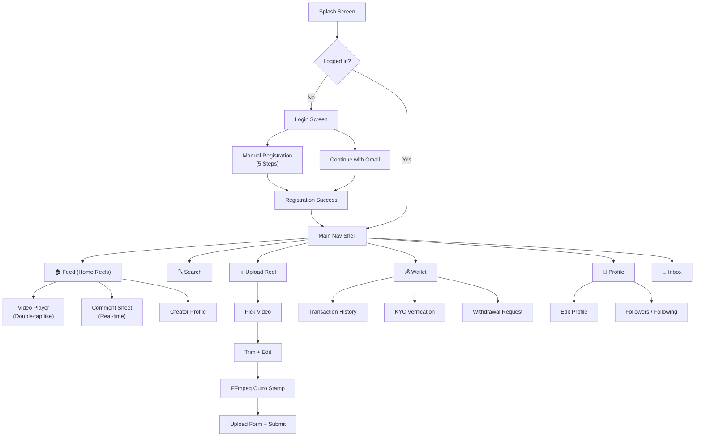

# 📱 Telso World — Product Requirements Document (PRD)
**Version:** 2.0.0  
**Date:** November 2026  
**Status:** 🟢 Active Development  
**Platform:** Android · iOS · Web  
**Author:** Telso World Engineering Team

---

## 1. Product Overview

**Telso World** is a short-video social platform where creators — primarily musicians and students — upload video reels, earn real money through engagement (views, likes, comments), and grow their audience. Advertisers post sponsored reels; every user who watches, likes, or comments on an ad reel earns a payout set per-video by the admin. Users grow through a dynamic referral system, real-time social graph (follow/following), and an in-app wallet with KYC verification.

---

## 2. Tech Stack

| Layer | Technology | Details |
|---|---|---|
| **Frontend (Mobile)** | Flutter (Dart) | GetX state management · Android · iOS · Web |
| **Backend** | Node.js + Express.js | REST API, JWT Auth, Multer uploads, port `5050` |
| **Database** | PostgreSQL | Relational schema, JSONB, real-time counters |
| **Real-time** | WebSocket / Socket.IO | Live likes, comments, followers, notifications |
| **Video Processing** | FFmpeg (`ffmpeg_kit_flutter_new_min_gpl`) | Trim, encode, audio preserve, Telso outro stamp |
| **Authentication** | JWT + Google OAuth 2.0 | Manual registration & Gmail sign-in |
| **Storage** | Local `server/uploads/` → (Prod: S3/GCS) | Videos, thumbnails, profile images |
| **Admin Panel** | HTML/CSS/JS SPA | Served from `server/public/admin/` |

---

## 3. User Roles

| Role | Description |
|---|---|
| `creator` | Uploads normal reels; earns on own video engagement |
| `advertiser` | Uploads ads reels with per-engagement budget |
| `viewer` | Watches, likes, comments on ads reels → earns payout |
| `admin` | Manages everything — payouts, bans, referral, settings |

---

## 4. Registration & Authentication

### 4.1 Two Registration Paths

```
Registration Screen
│
├── [Continue with Gmail]  → Google OAuth 2.0
│       └── Pre-fills: name, email, profile photo
│           → Continue to Step 2 (profile details)
│
└── [Manual Registration]  → 5-step form flow
```

### 4.2 Manual Registration — Step-by-Step Flow

| Step | Fields | Validation |
|---|---|---|
| **Step 1 — Account** | Username, Mobile No., WhatsApp No. | Username unique, mobile 10-digit, WhatsApp optional |
| **Step 2 — Personal** | Full Name, Date of Birth (Happy Birthday 🎂), State, District, School/College Name | DOB ≥ 13 years |
| **Step 3 — Account Type** | User Type (Musician / Student / Creator / Other) | Required selection |
| **Step 4 — Security** | Password, Confirm Password | Min 8 chars, match |
| **Step 5 — Referral & T&C** | Referral Code (optional), Accept Terms & Conditions checkbox | T&C must be checked to proceed |

> **Gmail Registration** skips to Step 5 after OAuth, pre-filling name & email.

### 4.3 T&C Requirement
- Checkbox: *"I agree to Telso World's Terms & Conditions and Privacy Policy"*
- Cannot proceed to registration without checking this box
- T&C link opens in-app WebView

### 4.4 Login Options
- Username + Password
- Continue with Gmail (Google Sign-In)
- Forgot Password → OTP via SMS / Email

---

## 5. Reel Types

### 5.1 Normal Reels
- Uploaded by creators
- **Creator earns** when other users engage with their reel
- Payout per reel is set by admin (global default or per-video override)
- Status flow: `Pending` → `Approved` / `Rejected` by admin

### 5.2 Advertisement Reels
- Uploaded by advertisers with a budget and CTA link
- **Viewer earns** money for every:
  - 👁️ **View** (watches ≥ 70% of the reel)
  - ❤️ **Like** (taps like on the ads reel)
  - 💬 **Comment** (posts a comment on the ads reel)
- Each video has **individual payout amounts** set per-video by admin:

| Engagement | Configured Per Video | Default (admin-set) |
|---|---|---|
| View payout | ₹X per view | Admin global default |
| Like payout | ₹X per like | Admin global default |
| Comment payout | ₹X per comment | Admin global default |

> **Rules:**
> - A user earns view payout **only once** per video
> - A user earns like payout **only once** per video
> - A user earns comment payout **only once** per video
> - `earned_like_users`, `earned_comment_users`, `viewed_by` JSONB arrays track this
> - Admin can override per-video payouts at any time
> - Admin sets **global defaults** that apply to all new ads videos unless overridden

---

## 6. Admin Controls

### 6.1 Payout Management
- Set **global default** like payout (₹ per like)
- Set **global default** comment payout (₹ per comment)
- Set **global default** view payout (₹ per view)
- Override any of above **per individual video**
- Changes take effect immediately on all future earnings

### 6.2 Referral System (Dynamic)
- Admin sets referral reward amount (₹) — changes reflected immediately
- Referral reward credited when: referred user completes registration
- Admin can run **referral campaigns** (e.g., double reward for 7 days)
- Referral chain tracked: `referred_by` column on users

### 6.3 User Management
- Activate / Deactivate users
- **Ban user** — immediately revokes JWT, blocks all API access, marks `status = 'banned'`
- View user transactions and wallet balance

### 6.4 Video Management
- Approve / Reject uploaded reels
- Delete any video
- Set per-video payout amounts for ads reels

### 6.5 Settings
- App name, referral reward, minimum withdrawal
- SMS gateway config (JSONB)
- SMTP config (JSONB)
- Firebase FCM config (JSONB)
- Platform-level feature flags

---

## 7. Real-Time Social Features (Instagram-style)

All counts and states update **in real-time** via WebSocket/Socket.IO:

| Feature | Real-time Update |
|---|---|
| ❤️ Like count | Instant on all viewers of that reel |
| 💬 Comment count | Live comment thread updates |
| 👥 Followers count | Updates on profile instantly |
| 🔔 Notification badge | Bell icon counter updates live |
| 💰 Wallet balance | Earnings credited instantly |
| 👣 Following count | Updates when you follow/unfollow |

### 7.1 Follow / Following System
- Follow a creator → appears in their followers list
- Following feed option (see only reels from people you follow)
- Follower / Following count on profile
- Mutual follow → "Friends" badge

---

## 8. Video Player Experience

### 8.1 Reel Playback
- Full-screen vertical swipe (TikTok/Reels style)
- Auto-play with sound on scroll
- **Double-tap anywhere on video → ❤️ Like** (Instagram-style animation)
- Single-tap → Pause/Resume
- Mute button top-right

### 8.2 Telso World Outro Watermark 🎬
> **Every reel** (normal + ads) must end with:
> - Telso World logo/icon (bottom-center or full overlay)
> - **Telso World tune/jingle** playing for last 2–3 seconds
> - Applied **automatically** during upload processing via FFmpeg
> - Outro cannot be removed by creator

### 8.3 Feed Interaction Controls

| Action | Gesture / UI |
|---|---|
| Like | Double-tap video **OR** tap ❤️ button |
| Unlike | Tap ❤️ again (toggle) |
| Comment | Tap 💬 icon → bottom sheet opens |
| Share | Tap ➦ icon → native share sheet (WhatsApp, etc.) |
| Follow creator | Tap "+ Follow" button on reel |
| View profile | Tap creator avatar/name |

---

## 9. Profile Screen

### 9.1 Profile Layout
- Cover photo + Profile picture (circular)
- Display name + @username
- Bio text (editable)
- Follower count · Following count · Reel count — tappable
- **Edit Profile** button
- Verification badge (✅ if KYC verified)

### 9.2 Profile Grid
- Smooth scrollable grid of uploaded reels (3-column)
- Lazy-loads on scroll (pagination)
- Tap reel → opens fullscreen player

### 9.3 Tabs on Profile
| Tab | Content |
|---|---|
| 🎬 Reels | Own uploaded videos |
| ❤️ Liked | Videos this user liked |
| 🔖 Saved | Bookmarked videos (future) |

---

## 10. Wallet & Verification

### 10.1 Wallet
- Current balance (₹)
- Pending balance (not yet settled)
- Transaction history (credit / debit with timestamps)
- Earnings breakdown: View earnings · Like earnings · Comment earnings · Referral earnings

### 10.2 KYC Verification
- User submits: Aadhaar / PAN / Bank details
- Verification status: `unverified` → `pending` → `verified`
- Verified badge shown on profile (✅)
- Withdrawals only allowed for `verified` users

### 10.3 Withdrawal
- Minimum withdrawal: admin-configured (default ₹100)
- Payment via UPI ID
- Request → Admin approval → Paid
- Status tracking: `pending` → `approved` / `rejected`

---

## 11. Notifications (Real-time)
- 🔔 Bell icon with live badge count
- Triggered by: likes on your video, new comments, new follower, referral joined, payout credited, withdrawal status
- Inbox screen with mark-as-read

---

## 12. API Reference

### Base URL
```
http://<host>:5050/api
```

| Method | Endpoint | Auth | Description |
|---|---|---|---|
| `POST` | `/reporter/register` | ❌ | Manual registration (5-step data) |
| `POST` | `/reporter/register/gmail` | ❌ | Gmail OAuth registration |
| `POST` | `/reporter/login` | ❌ | Login → JWT |
| `POST` | `/reporter/login/gmail` | ❌ | Gmail OAuth login |
| `POST` | `/reporter/logout` | ✅ | Logout |
| `GET` | `/reporter/dashboard` | Optional | Normal reels feed |
| `GET` | `/reporter/ads-all-videos` | Optional | Ads reels feed |
| `POST` | `/reporter/normal-video/view` | ✅ | Record view + payout check |
| `POST` | `/reporter/normal-video/like` | ✅ | Like/unlike |
| `POST` | `/reporter/adsvideo/view` | ✅ | View ad + credit payout |
| `POST` | `/reporter/adsvideo/like` | ✅ | Like ad + credit payout |
| `POST` | `/reporter/upload-video` | ✅ | Upload reel (multipart/form-data) |
| `GET` | `/reporter/wallet` | ✅ | Wallet balance + transactions |
| `GET` | `/reporter/referral` | ✅ | Referral info |
| `GET` | `/reporter/profile/:username` | Optional | Public profile |
| `POST` | `/reporter/follow` | ✅ | Follow a user |
| `DELETE` | `/reporter/follow` | ✅ | Unfollow a user |
| `GET` | `/reporter/followers/:userId` | ✅ | Followers list |
| `GET` | `/reporter/following/:userId` | ✅ | Following list |
| `GET` | `/comments` | Optional | Fetch comments (paginated) |
| `POST` | `/comments/add` | ✅ | Add comment + credit payout |
| `POST` | `/comments/like` | ✅ | Like a comment |
| `POST` | `/reporter/kyc` | ✅ | Submit KYC documents |
| `GET` | `/api/health` | ❌ | Health check |

---

## 12.5 Light & Dark Mode

### Mode Options
| Mode | Behavior |
|---|---|
| ☀️ Light | White/light backgrounds, dark text |
| 🌙 Dark | Deep dark `#09090E` background, light text |
| ⚙️ System | Follows device OS setting, auto-switches |

### Key Design Rules
- All colors defined via `ThemeData` tokens — **zero hardcoded colors** in widgets
- Theme choice saved to `shared_preferences` → persists across restarts
- Toggle: sun/moon icon in profile header + **Settings → Appearance**
- Splash screen is always dark regardless of mode
- Admin Panel (web) uses CSS `prefers-color-scheme` media query

### Sprint Assignment
> Light/Dark mode → **Sprint 5** (Polish phase)  
> ThemeData scaffolding → **Sprint 1** (set up `app_theme.dart` from start)

---

## 13. Database Schema (PostgreSQL)

```mermaid
erDiagram
    users {
        int id PK
        text username UK
        text email
        text mobile_no
        text whatsapp
        text name
        text dob
        text state
        text district
        text school_name
        text user_type
        text password
        text referral_code UK
        text referred_by
        text role
        text status
        text profile_image
        text bio
        text auth_provider
        text google_id
        boolean terms_accepted
        timestamptz created_at
    }
    videos {
        int id PK
        int user_id FK
        text title
        text video_url
        text thumbnail_url
        text video_type
        text status
        int view_count
        int likes_count
        int comments_count
        int shares_count
        boolean has_audio
        boolean has_outro
        numeric view_payout
        numeric like_payout
        numeric comment_payout
        jsonb liked_by
        jsonb viewed_by
        jsonb earned_like_users
        jsonb earned_comment_users
    }
    follows {
        int id PK
        int follower_id FK
        int following_id FK
        timestamptz created_at
    }
    comments {
        int id PK
        int video_id FK
        int user_id FK
        text comment
        int likes
        jsonb liked_by
        int parent_id FK
    }
    wallets {
        int user_id PK_FK
        numeric balance
        numeric pending_amount
        numeric total_view_earned
        numeric total_like_earned
        numeric total_comment_earned
        numeric total_referral_earned
    }
    transactions {
        text id PK
        int user_id FK
        text title
        numeric amount
        text type
        text status
        text source_type
    }
    withdrawals {
        text id PK
        int user_id FK
        numeric amount
        text upi_id
        text status
    }
    kyc {
        int id PK
        int user_id FK
        text doc_type
        text doc_number
        text doc_image_url
        text status
    }
    notifications {
        text id PK
        int user_id FK
        text title
        text message
        text type
        boolean is_read
    }
    settings {
        int id PK
        numeric referral_reward
        numeric min_withdrawal
        numeric default_view_payout
        numeric default_like_payout
        numeric default_comment_payout
        jsonb sms
        jsonb smtp
        jsonb firebase
    }

    users ||--o{ videos : "uploads"
    users ||--o{ comments : "writes"
    users ||--|| wallets : "has"
    users ||--o{ transactions : "has"
    users ||--o{ withdrawals : "requests"
    users ||--o{ notifications : "receives"
    users ||--o{ follows : "follows"
    users ||--o{ kyc : "submits"
    videos ||--o{ comments : "has"
```

---

## 14. Flutter App — Navigation Flow



---

## 15. Known Issues & Risks

| # | Issue | Severity | Status |
|---|---|---|---|
| 1 | Video without audio silently fails | 🔴 High | Fixed via FFmpeg |
| 2 | Physical device needs correct LAN IP | 🟡 Med | Manual config |
| 3 | `liked_by` as JSONB — needs migration to `follows` table at scale | 🟡 Med | Planned |
| 4 | No Firebase push yet | 🟡 Med | Sprint 3 |
| 5 | No rate limiting on upload endpoint | 🔴 High | Sprint 2 |
| 6 | No HTTPS on admin panel | 🔴 High | Before production |
| 7 | Google OAuth not wired yet | 🔴 High | Sprint 1 |
| 8 | Outro watermark not applied yet | 🔴 High | Sprint 2 |
| 9 | WebSocket/real-time not implemented | 🔴 High | Sprint 3 |
| 10 | KYC flow missing | 🟡 Med | Sprint 3 |

---

## 16. Future Roadmap

| Feature | Priority |
|---|---|
| Firebase Cloud Messaging (push) | 🔴 High |
| CDN for video delivery (S3/GCS) | 🔴 High |
| Rate limiting + abuse prevention | 🔴 High |
| HTTPS / SSL (nginx reverse proxy) | 🔴 High |
| Live streaming | 🟡 Med |
| Duet / Stitch feature | 🟢 Low |
| In-app music library | 🟢 Low |
| Analytics dashboard for creators | 🟢 Low |

---

*Document generated from live codebase: `/Users/sahilkhan/FlutterDev/TelsoWorld`*  
*Last updated: November 2026 · v2.0.0*

